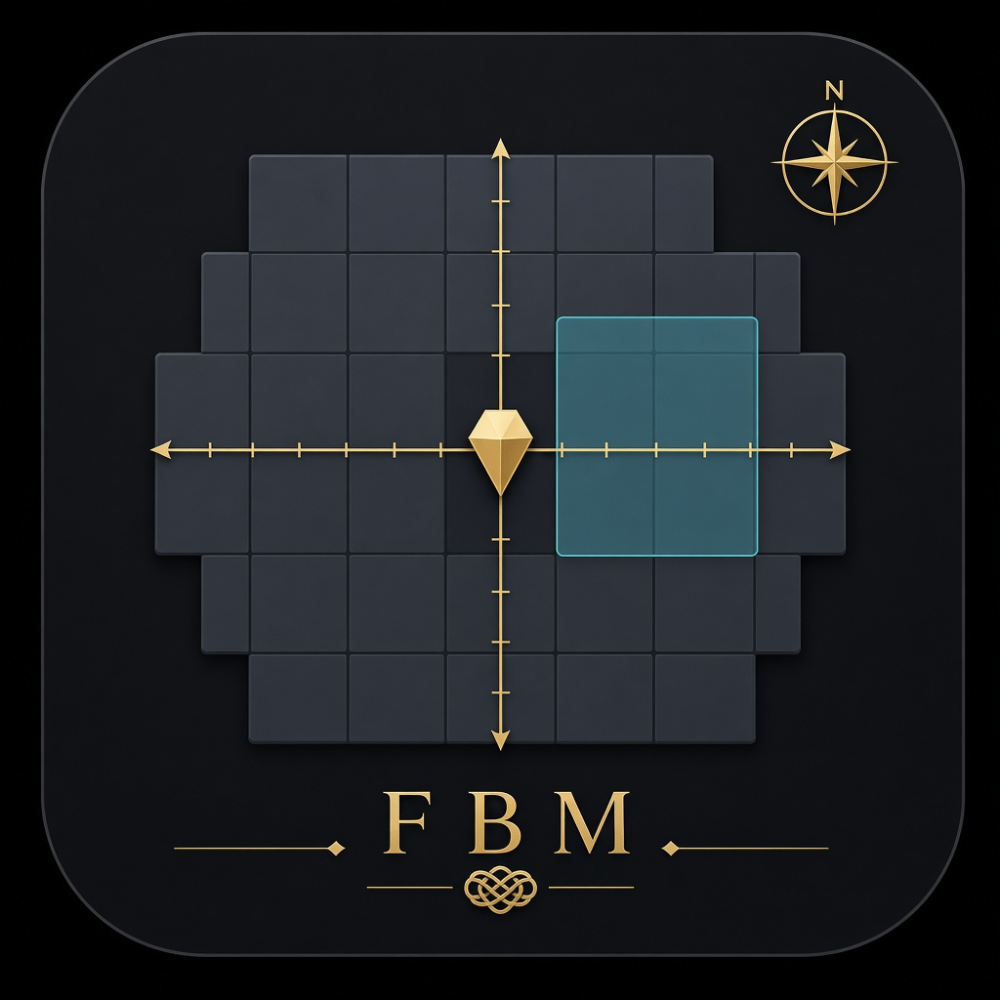
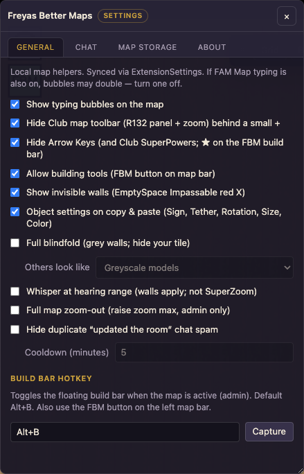
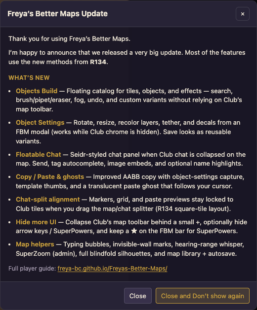
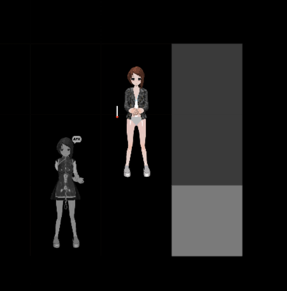
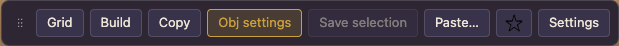
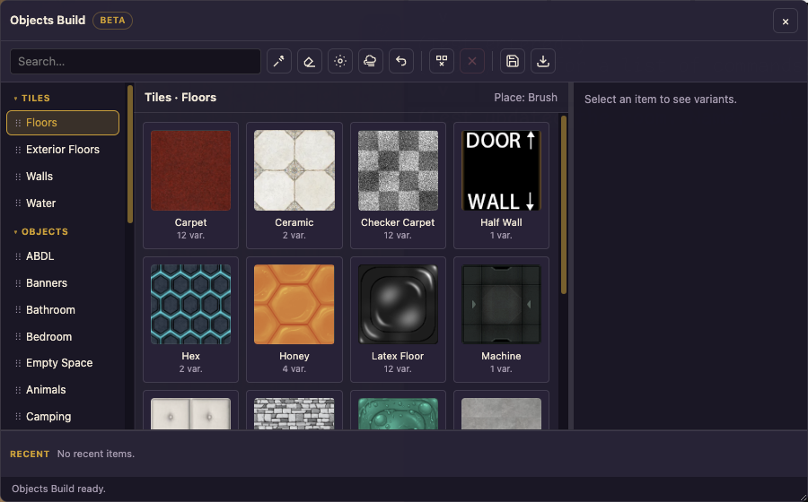
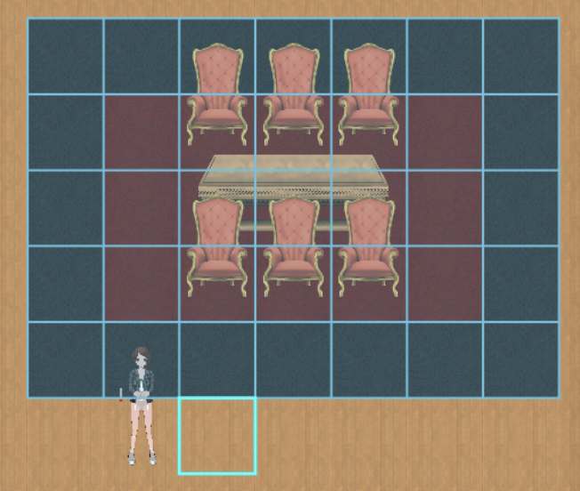
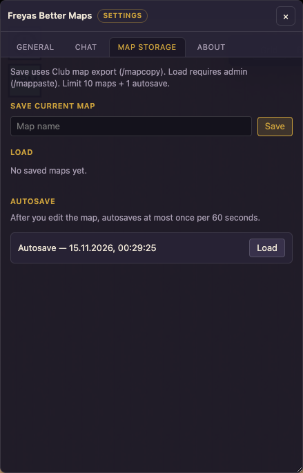
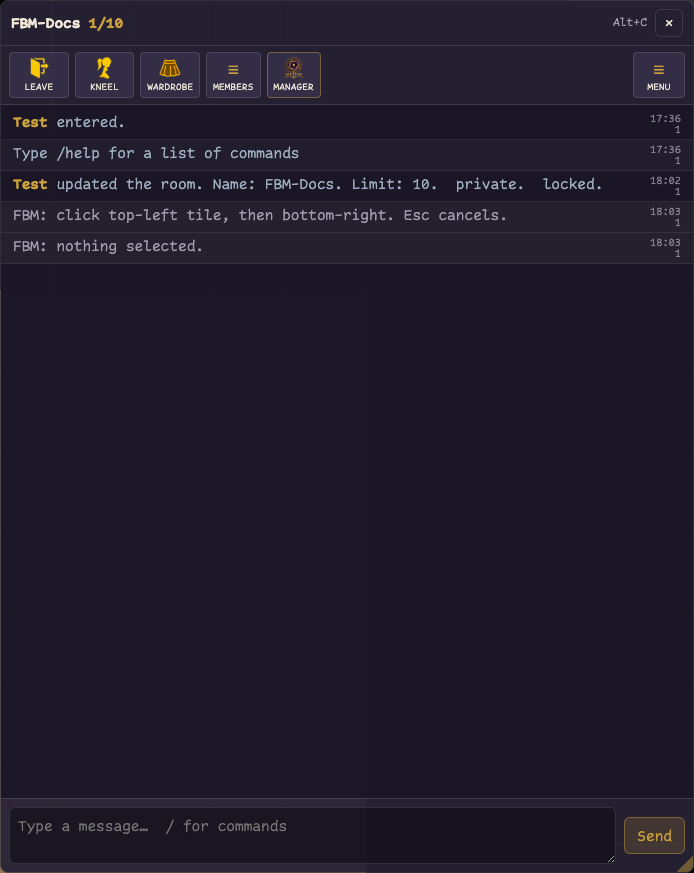

# Freyas Better Maps

**Freyas Better Maps** is a Bondage Club plugin for map rooms: typing bubbles, collapsed Club chrome, build tools, Objects Build, copy/paste templates, a small map library with autosave, hearing-range whisper, SuperZoom, full blindfold silhouettes, and Floatable Chat when Club chat is collapsed.

| | |
|---|---|
| **Version** | 0.1.124 |
| **Author** | Freya |
| **Pages** | https://freya-bc.github.io/Freyas-Better-Maps/ |
| **FUSAM loader** | https://freya-bc.github.io/Freyas-Better-Maps/loader.js |

---

## Table of contents

1. [Install](#install)
2. [Getting started](#getting-started)
3. [Feature overview](#feature-overview)
4. [Map View](#map-view)
5. [Build Bar](#build-bar)
6. [Objects Build](#objects-build)
7. [Copy & Paste](#copy--paste)
8. [Map Storage](#map-storage)
9. [Floatable Chat](#floatable-chat)
10. [Commands](#commands)
11. [Settings](#settings)
12. [Coexistence](#coexistence)
13. [Storage](#storage)
14. [Detailed docs](#detailed-docs)

---

## Install

Use **one** of these after you are logged into Bondage Club:

| Method | How |
|--------|-----|
| **Bookmark (recommended)** | Copy the one-line `javascript:` URL from [`bookmark.js`](bookmark.js) into a browser bookmark. Click it in Club after login. Loads the gist IIFE. Click again after an update to reload. |
| **Tampermonkey** | Install [`freyas-better-maps.user.js`](freyas-better-maps.user.js), reload Club, log in. |
| **FUSAM** | Add [`loader.js`](loader.js) / see [`fusam-entry.json`](fusam-entry.json). Loads sibling `freyas-better-maps.js` after login. |

Requires a ModSDK host such as **BCX** (hooks go through ModSDK).

Open settings anytime with **Preference → Extensions → Freyas Better Maps**, or the build bar **Settings** button when you are editing a map.

---

## Getting started

1. **Load the plugin** — bookmark, Tampermonkey, or FUSAM (see Install).
2. **Open Settings** — Preference → Extensions → Freyas Better Maps. A draggable panel opens and returns you to the game.
3. **Join a map room** — most features only appear while Club map view is active.
4. **What’s new** — a bottom-right update banner may appear after big releases; About → **What’s new** reopens it.

---

## Feature overview

| Area | What it does |
|------|----------------|
| **Map View QoL** | Typing bubbles, hide Club toolbar / arrows, invisible walls, full blindfold, hearing whisper, SuperZoom |
| **Build Bar** | Admin toolbar: Grid, Build, Copy, Obj settings, Paste, Settings (+ ★ SuperPowers) |
| **Objects Build** | Floating tile/object/effect catalog with brush, tools, and custom variants |
| **Object Settings** | Rotate / size / color / tether / decal modal that works with Club chrome hidden |
| **Copy & Paste** | AABB selection, local templates, translucent paste ghost |
| **Map Storage** | Up to 10 named maps + local autosave; admin load syncs the room |
| **Floatable Chat** | Seidr-styled float panel when Club chat is collapsed |
| **Commands** | `/fbm`, `/build`, `/chat` |

---

## Map View

Typing bubbles, collapsed Club chrome, blindfold silhouettes, whisper range, and SuperZoom.

Details: [MAP_VIEW.md](docs/MAP_VIEW.md).

---

## Build Bar

Admin-only floating bar for grid, build catalog, copy/paste, and Settings.

Details: [BUILD_BAR.md](docs/BUILD_BAR.md).

---

## Objects Build

Floating catalog for tiles, objects, and effects — works with Club’s map toolbar hidden.

Details: [OBJECTS_BUILD.md](docs/OBJECTS_BUILD.md).

---

## Copy & Paste

Select a region, save a template, paste with a ghost preview.

Details: [COPY_PASTE.md](docs/COPY_PASTE.md).

---

## Map Storage

Named saves (synced) and a 60s autosave slot (this device).

Details: [MAP_STORAGE.md](docs/MAP_STORAGE.md).

---

## Floatable Chat

Movable chat panel for map rooms when Club chat is collapsed.

Details: [FLOATABLE_CHAT.md](docs/FLOATABLE_CHAT.md).

---

## Commands

| Command | Effect |
|---------|--------|
| `/fbm` | Open build bar (room admin, map view) |
| `/build` | Open Objects Build (room admin) |
| `/chat` | Toggle Floatable Chat |

Details: [COMMANDS.md](docs/COMMANDS.md).

---

## Settings

Tabs: **General** | **Chat** | **Map storage** | **About**.

Details: [SETTINGS.md](docs/SETTINGS.md).

---

## Coexistence

- **FAM Map typing** — if both typing indicators are on, bubbles may double; turn one off.
- **FAM Map tools** — overlap with map helpers is user-managed.
- **Seidr** — Floatable Chat wires Tab / Fast Select into Seidr when loaded; Room Manager appears on the float toolbar; Seidr’s floating ⌂ hides while the float panel is open.

---

## Storage

| Data | Where |
|------|--------|
| Settings | `Player.ExtensionSettings.FreyasBetterMaps` |
| Map library (compressed) | `Player.ExtensionSettings.FreyasBetterMapsMaps` |
| Window geometry, autosave | `localStorage` (this device only) |
| Copy templates, Objects Build customs / recent | `localStorage` |
| Oversized map saves | localStorage overflow (badge in Map storage list) |

---

## Detailed docs

| Guide | Contents |
|-------|----------|
| [MAP_VIEW.md](docs/MAP_VIEW.md) | Typing, toolbar, arrows, blindfold, whisper, zoom |
| [BUILD_BAR.md](docs/BUILD_BAR.md) | Opening the bar, grid, sync stamp |
| [OBJECTS_BUILD.md](docs/OBJECTS_BUILD.md) | Catalog + Object Settings |
| [COPY_PASTE.md](docs/COPY_PASTE.md) | Selection, templates, paste ghost |
| [MAP_STORAGE.md](docs/MAP_STORAGE.md) | Saves and autosave |
| [FLOATABLE_CHAT.md](docs/FLOATABLE_CHAT.md) | Float panel features |
| [COMMANDS.md](docs/COMMANDS.md) | Slash commands |
| [SETTINGS.md](docs/SETTINGS.md) | Full settings reference |
