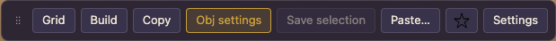
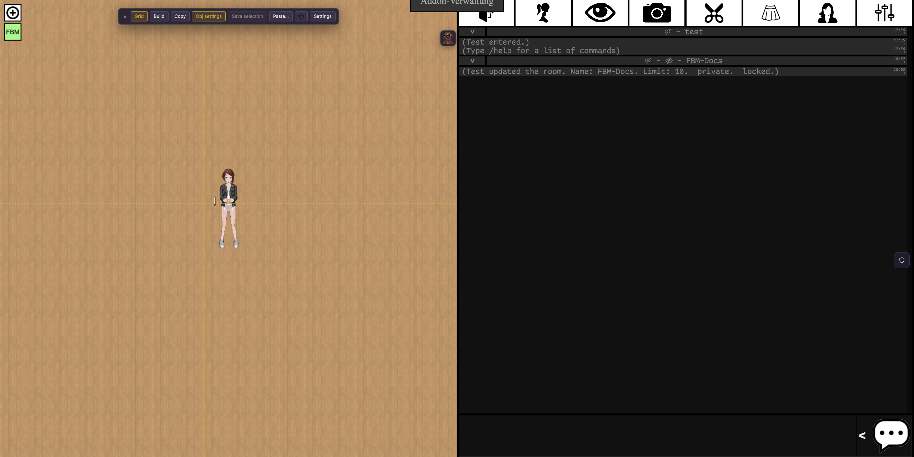
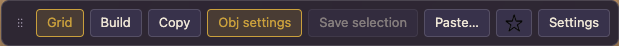

# Build Bar

The FBM build bar is a floating admin toolbar for grid, Objects Build, region copy/paste, SuperPowers (when arrows are hidden), and Settings. It stays hidden until you open it.

## When to use this

Use the build bar when you are a **room admin** editing a map and want FBM tools without keeping Club’s full map chrome open.

## Requirements

| | |
|---|---|
| Setting | **Allow building tools** (General) |
| Role | Room **admin** |
| View | Map view in a Hybrid/Always map room |

---

## How to open

1. Enable **Allow building tools** under Settings → General.
2. On the map, click the **FBM** button on the left map strip (under **+** when Club tools are collapsed, under **−** when the Club panel is open), **or**
3. Press the build-bar hotkey (default **Alt+B**), **or**
4. Type **`/fbm`** in chat.

The bar opens at the **top-center** of the map area. Drag the **⋮⋮** grip to move it. Hiding and showing the bar resets it to the default spot.

Change the hotkey under General → **Build bar hotkey** (Capture or type e.g. `Alt+B`).

While focus is in FBM fields, **WASD** will not move you on the map.

---

## Buttons

| Button | Action |
|--------|--------|
| **Grid** | Toggle 5-tile grid + center X/Y axes |
| **Build** | Open Objects Build catalog |
| **Copy** | Start AABB selection |
| **Obj settings** | Include Sign / Tether / rotation / size / colors when saving a selection |
| **Save selection** | Store the current selection as a local template |
| **Paste…** | Open template picker (disabled while Copy selection is active) |
| **★** | Toggle Club SuperPowers (shown when Hide Arrow Keys is on) |
| **Settings** | Open the FBM settings panel |

---

## Grid overlay

Click **Grid** on the bar. State is remembered (`gridOn` in settings).

---

## Sync stamp & room-update spam

When **Hide duplicate “updated the room” chat spam** is enabled, matching Club update lines are suppressed for a cooldown (default 5 minutes). The editor still sees a short stamp on the build bar:

`Saved & synced · HH:MM:SS`

---

## Tips

- Paste is disabled while a Copy selection is active — finish or Esc first.
- Leaving map view or the room closes the bar automatically.

## Related

- [OBJECTS_BUILD.md](OBJECTS_BUILD.md)
- [COPY_PASTE.md](COPY_PASTE.md)
- [COMMANDS.md](COMMANDS.md)
- [SETTINGS.md](SETTINGS.md)
