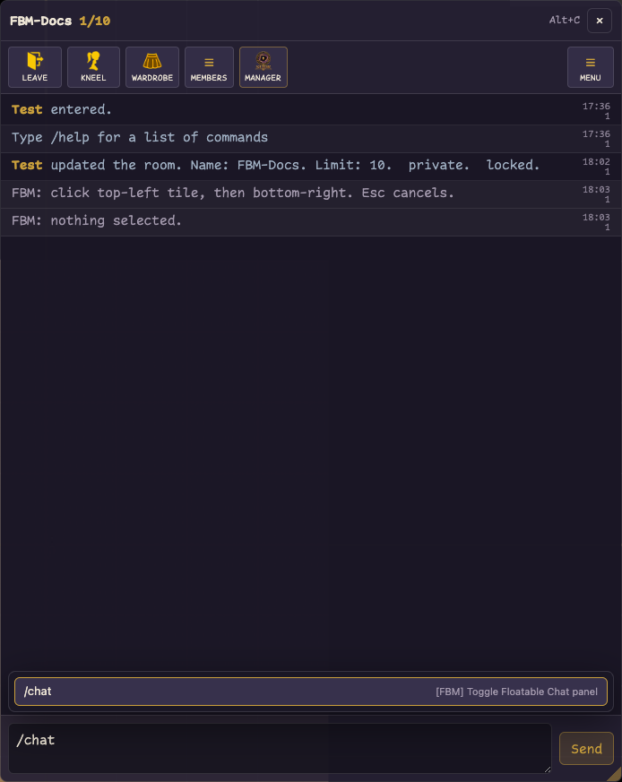

# Commands

Freyas Better Maps registers a few chat slash commands for quick access. They run through Club chat (including Floatable Chat compose).



## Command table

| Command | Who | Effect |
|---------|-----|--------|
| `/fbm` | Room admin | Opens the [build bar](BUILD_BAR.md) on the map |
| `/build` | Room admin | Opens [Objects Build](OBJECTS_BUILD.md) |
| `/chat` | Anyone with Floatable Chat enabled | Toggles [Floatable Chat](FLOATABLE_CHAT.md) |

---

## Quick starts

### Build bar

```
/fbm
```

Requires map view + admin + **Allow building tools**.

### Objects Build

```
/build
```

Same admin / map requirements as the build bar **Build** button.

### Floatable Chat

```
/chat
```

Also: hotkey **Alt+C** (configurable) or Settings → Chat → **Show float chat**.

---

## Tips

- Club **`/`** tag autocomplete still works in Floatable Chat.
- With Seidr loaded, Seidr slash commands and Tab AC work from the float compose field.

## Related

- [BUILD_BAR.md](BUILD_BAR.md)
- [OBJECTS_BUILD.md](OBJECTS_BUILD.md)
- [FLOATABLE_CHAT.md](FLOATABLE_CHAT.md)
- [SETTINGS.md](SETTINGS.md)
