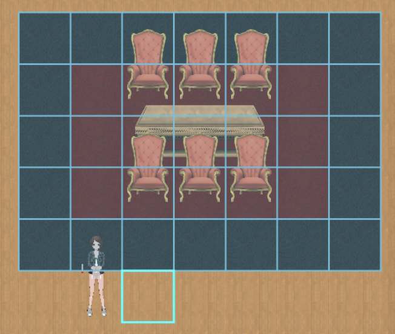
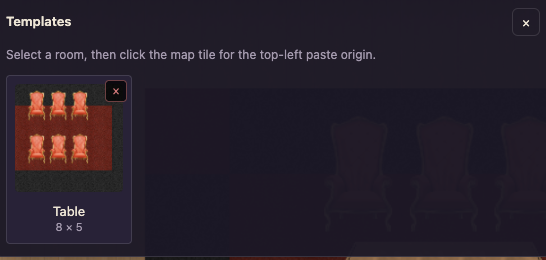
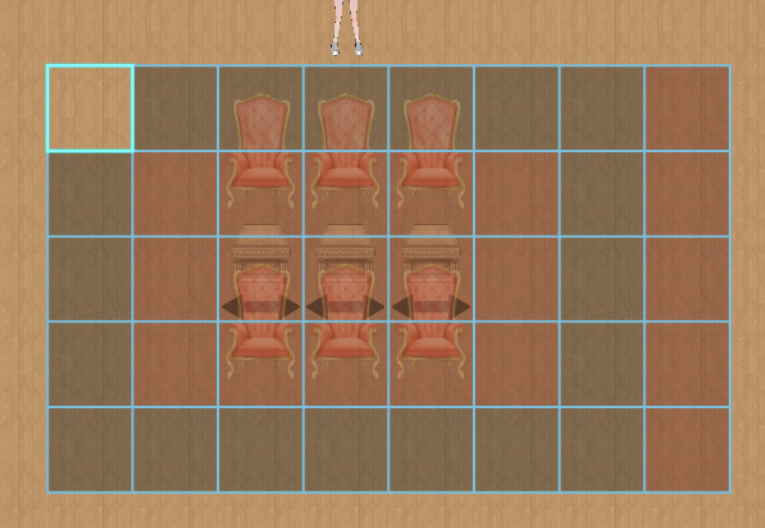

# Copy & Paste

Copy a rectangle of map tiles into a local template, then paste it elsewhere with a translucent ghost preview. Object settings (Sign text, Tether, Teleporter links, rotation, size, colors) can be included.

## When to use this

Use copy/paste when rebuilding rooms, duplicating furniture clusters, or keeping a library of reusable map snippets.

## Requirements

| | |
|---|---|
| Role | Room admin with build bar open |
| Setting | **Object settings on copy & paste** (General) controls whether settings ride along |

---

## Select

1. Build bar → **Copy**.
2. Click / drag tiles for an AABB selection (toggle tiles as needed).
3. Local chat shows a short FBM hint; **Esc** cancels.

---

## Obj settings

**Obj settings** on the build bar (and the General default) controls whether Sign text, Tether points, Teleporter links, Rotation, Size, and Colors are included when you **save** a selection.

At **paste** time, turn Obj settings off to place tiles/objects only even if the template stored settings.

Teleporter destinations are **remapped** relative to the paste origin.

---

## Save selection

**Save selection** stores a thumbnail (real map assets when loaded) into local templates.

---

## Paste

1. Click **Paste…** (disabled while Copy selection is active).
2. Choose a template from the picker.
3. Aim with the translucent ghost + cyan origin, then click the top-left origin tile.

Paste syncs through Club’s MapManager (same path as map paint / room Update). Overlay markers, grid, and paste ghosts stay aligned when you drag the chat/map splitter (R134 square tiles).

One **Undo** (Club map Undo / Objects Build Undo) reverts the whole paste — same stroke grouping Club uses for brush draws.

**Esc** cancels paste mode.

---

## Storage

Templates live in **localStorage** (not ExtensionSettings).

## Related

- [BUILD_BAR.md](BUILD_BAR.md)
- [OBJECTS_BUILD.md](OBJECTS_BUILD.md)
- [MAP_STORAGE.md](MAP_STORAGE.md)
