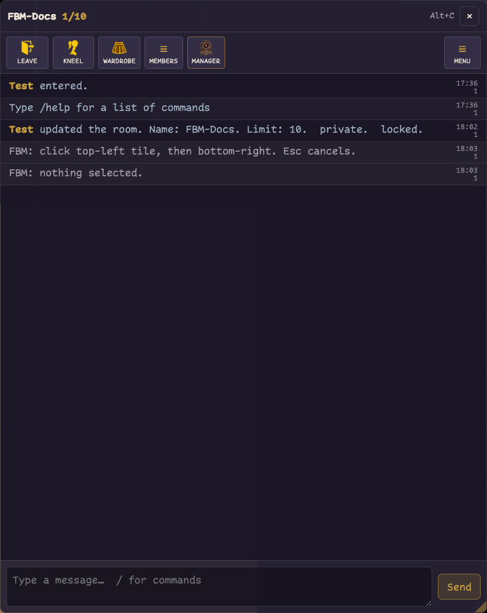
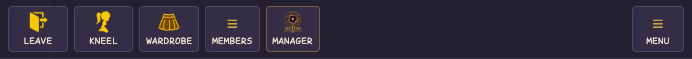
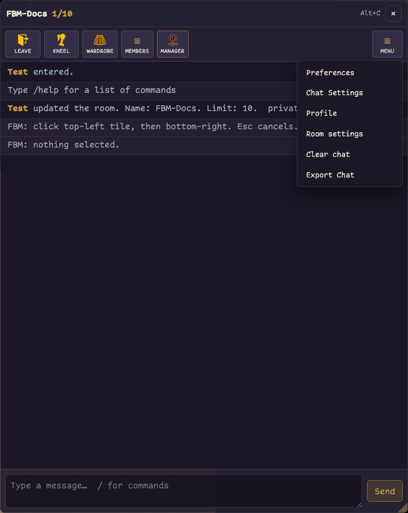
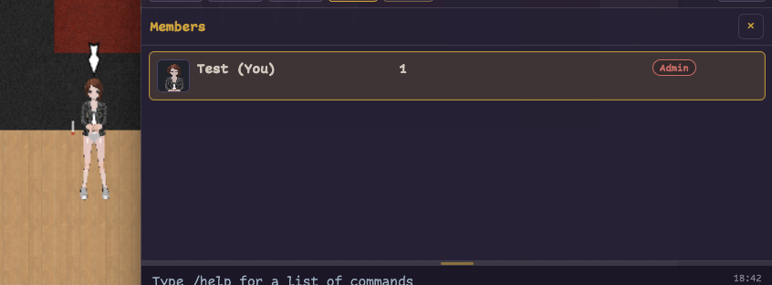
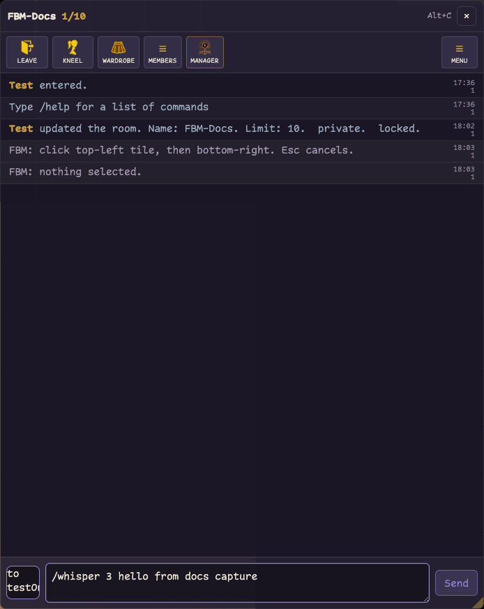
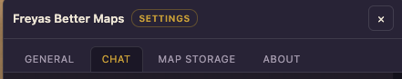
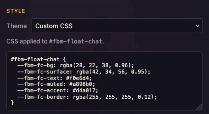

# Floatable Chat

Floatable Chat is a Seidr-styled, draggable / resizable chat panel for map rooms when Club chat is collapsed. It mirrors room messages, sends through Club’s input, and adds Members, Menu, highlights, image trust, and optional Seidr integration.

## When to use this

Use Floatable Chat whenever you hide Club’s default chat on the map and still want a readable, movable panel.

## Requirements

| | |
|---|---|
| Setting | **Enable Floatable Chat** (Chat tab, on by default) |
| Open | Hotkey (default **Alt+C**), **`/chat`**, Chat tab → **Show float chat**, or Autoshow |

---

## Open paths

1. Settings → **Chat** → enable Floatable Chat.
2. **Autoshow when default Club chat is hidden** pops the panel when Club chat collapses.
3. **Autoclose chat joining a room** collapses Club chat on join (toast warns if Autoshow is off).
4. Hotkey default **Alt+C** (Capture under Chat).
5. Slash: **`/chat`**.

---

## Toolbar

| Control | Action |
|---------|--------|
| Leave | Leave room (optional confirm) |
| Kneel / Stand | Toggle kneel |
| Wardrobe | Open wardrobe |
| Members | Docked members panel |
| Manager | Seidr Room Manager (when Seidr is loaded) |
| Menu | Preferences, Chat Settings, Profile, Room settings, Clear chat, Export Chat |

---

## Members

- Docks above the log (~30% height, drag-resize).
- Face portraits, ID click-to-copy, admin/friend pills.
- Admin Kick / Ban / Promote / Whitelist when you are room admin.
- Right-click social actions (same family as chat line context menus).
- Optional **map compass** on name hover (Chat settings).

---

## Compose

- Club **`/`** tag autocomplete; **`.`** Tab proxy through Club.
- Tab stays in the compose field.
- **Ctrl/Cmd+Enter** wraps the body in `()` (OOC).
- **OOC Protection** blocks unbalanced parentheses (on by default).
- Whispers / beeps show **from/to** labels; compose border turns purple (whisper) or teal (beep).
- Hover **↩** to reply (including your own messages).
- Click a name to copy the ID and prep `/whisper id`.
- Optional whisper avatar beside the input.

---

## Themes & readability

Under Settings → Chat:

- Text size 11–18
- Transparency 0–60% glass over the map
- Theme: Dark (Seidr) / Light Seidr / Custom CSS (applied to `#fbm-float-chat`)
- Font dropdown (type-to-jump) + Custom family
- Highlight own names/words (+ Seidr color or custom)
- Highlight other users’ names (Seidr color)

Trusted image hosts embed inline (WCE-style). Unknown hosts offer **Trust** / **Trust permanently**; manage the permanent list under Chat.

---

## Seidr integration

When Seidr is loaded:

- Float compose focus uses Seidr Tab / Fast Select / member·action AC (including `/beep` and `/whisper` assist).
- Room Manager appears on the toolbar.
- Seidr’s floating ⌂ hides while the float panel is open.
- Slash Seidr commands still run on send.

---

## Overlay suspend

While Club’s character dialog is open (`CurrentCharacter`), FBM overlays (float chat, settings, Objects Build, build bar) hide and restore after you leave the dialog.

---

## Map compass

Optional arrow on the map toward a player when you hover their name in **Members** or chat. Enable under Chat → **Map compass**.

## Related

- [SETTINGS.md](SETTINGS.md) — Chat tab
- [COMMANDS.md](COMMANDS.md)
- [MAP_VIEW.md](MAP_VIEW.md)
