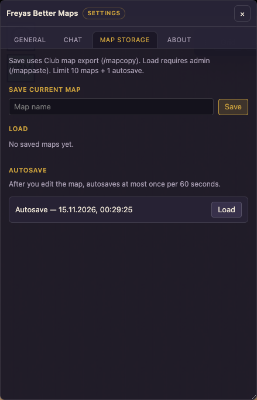

# Map Storage

Save up to **10 named maps** plus **one autosave** slot using Club’s `exportString` / `importString` format. Loading requires room admin and syncs the room like `/mappaste`.

## When to use this

Use Map storage for backups, alternate layouts of the same room, or recovering after a bad edit (autosave).

## Requirements

| | |
|---|---|
| Open | Settings → **Map storage** |
| Load | Room **admin** |

---

## Save

1. Open Settings → **Map storage**.
2. Enter a name and click **Save**.
3. When the synced library gets too large (~150 KB packed), the oldest maps become **overflow** entries: the full map stays in this device’s localStorage and the list shows an overflow badge.

---

## Load

Click **Load** on a saved map. Applies like `/mappaste` and **forces a room sync**. Delete removes the slot.

---

## Autosave

After map edits, autosave runs at most once per **60 seconds** into the autosave slot. Load it from the Autosave row when present. Autosave lives on this device only and is not available when you log in elsewhere.

---

## Storage

| Data | Where |
|------|--------|
| Named maps (compressed) | `ExtensionSettings.FreyasBetterMapsMaps` (synced to your account) |
| Autosave slot | `localStorage` only — **this device**, never uploaded |
| Full copies of oversized maps | `localStorage` (the synced copy keeps a name-only stub) |

Maps are uploaded only when you save or delete one, not when you change a setting or move a window.

## Related

- [COPY_PASTE.md](COPY_PASTE.md) — region templates (separate from full-map saves)
- [SETTINGS.md](SETTINGS.md)
- [BUILD_BAR.md](BUILD_BAR.md) — sync stamp while editing
