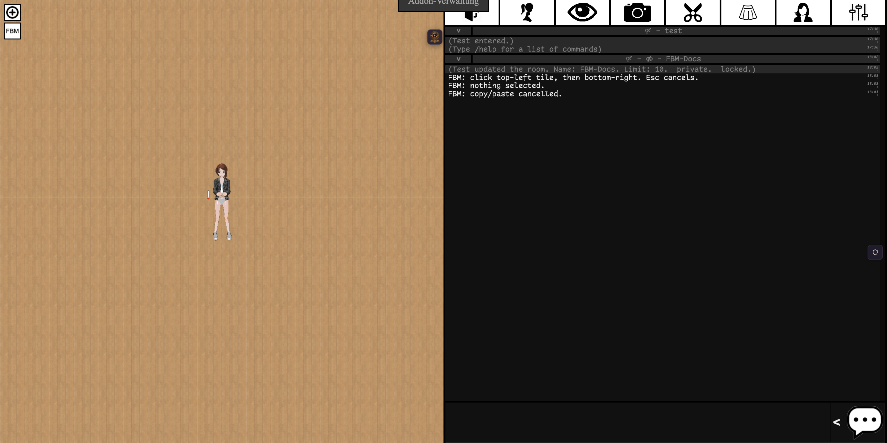
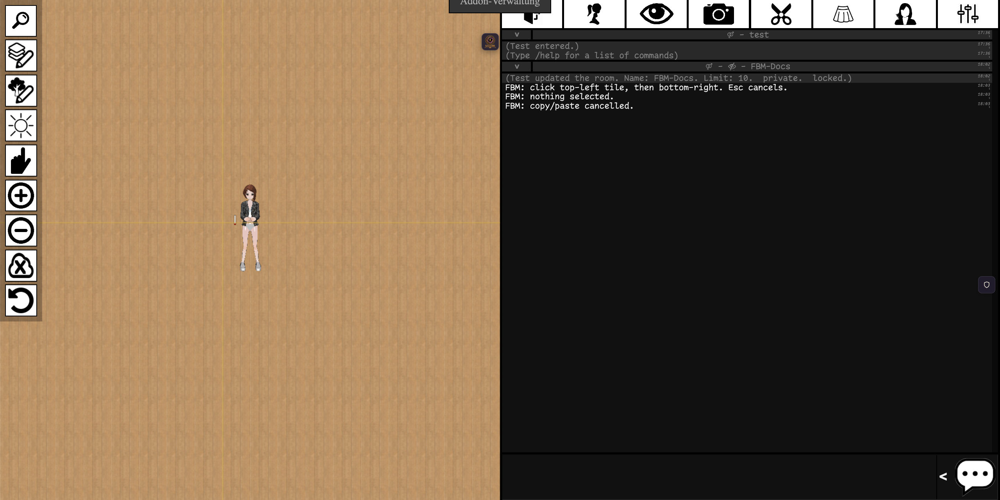
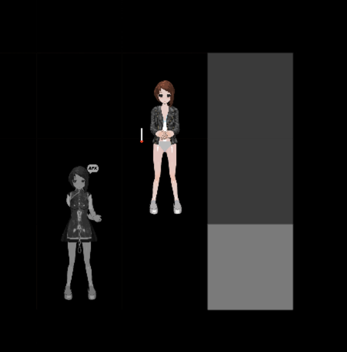
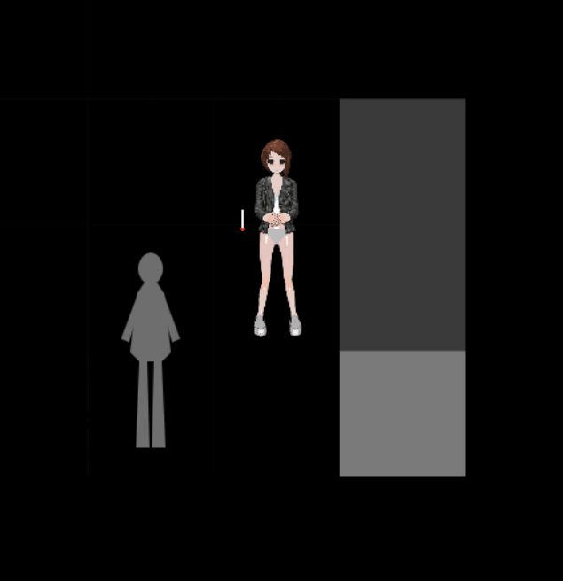
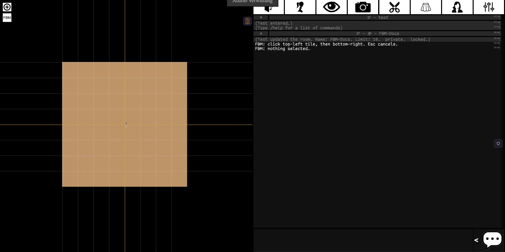

# Map View

Map View helpers improve everyday use of Club map rooms: typing bubbles, less chrome in the way, clearer walls when blind, safer whispers, and optional SuperZoom for admins.

## When to use this

Use these options whenever you play in a **map room**. Most toggles live under Settings → **General**. Effects apply while Club’s map view is active.

## Requirements

| | |
|---|---|
| Room | Map type **Hybrid** or **Always** |
| View | Club **Map** view (not Character lineup) |
| Admin | Only for **Full map zoom-out** effect |

---

## Typing bubbles

Shows a readable Talk-style bubble above characters who are typing on the map (same idea as Club’s Talk status, drawn over the map tile). Scales with zoom.

1. Enable **Show typing bubbles on the map** (on by default).
2. Join a map room and type — others with Freyas Better Maps see your bubble.

If **FAM Map** typing is also on, bubbles may stack; turn one of them off.

---

## Hide Club map toolbar

Collapses Club’s left map buttons and zoom controls behind a small **+** so the map stays clear.

1. Enable **Hide Club map toolbar** under General.
2. Click the small **+** on the left to expand Club’s tools again.
3. Click **−** to collapse.

Works with R132’s HTML map panel and canvas zoom buttons.

---

## Hide Arrow Keys

Hides Club’s on-map movement pad and SuperPowers control. **WASD** still moves you.

1. Enable **Hide Arrow Keys** under General.
2. As room admin, open the FBM build bar and use **★** to toggle SuperPowers the same way Club’s control would.

---

## Show invisible walls

Draws Club’s red **X** on `EmptySpace` **Impassable** cells (skips fog-hidden tiles).

Enable **Show invisible walls** under General.

---

## Full blindfold

At maximum Club blindness: walkable tiles black; **walls** darker grey; **other blockers** (doors, trees, glass, …) lighter grey. You still see your full-color avatar on your tile; only the **8 adjacent tiles** stay visible. Other players render as greyscale models or generic silhouettes.

1. Enable **Full blindfold** under General.
2. Choose **Others look like**: Greyscale models or Generic silhouette.
3. Equip a full blindfold in Club and stand on the map.

---

## Hearing-range whisper

Allows whisper when the target is Club-hearable (walls / audibility) and within hearing tiles. **SuperZoom does not widen whisper range.**

Enable **Whisper at hearing range** under General.

---

## Full map zoom-out (SuperZoom)

Raises Club’s map zoom maximum (default cap 7 → up to 50) so you can see more of the map. **Room admin only** — the checkbox is disabled for non-admins.

1. Enable **Full map zoom-out** under General while you are admin.
2. Use Club’s zoom controls to pull back.
3. If another mod already changed the zoom max away from Club’s defaults, FBM leaves it alone.

---

## Related

- [BUILD_BAR.md](BUILD_BAR.md) — admin toolbar and ★ SuperPowers
- [SETTINGS.md](SETTINGS.md) — General tab reference
- [README.md](../README.md)
