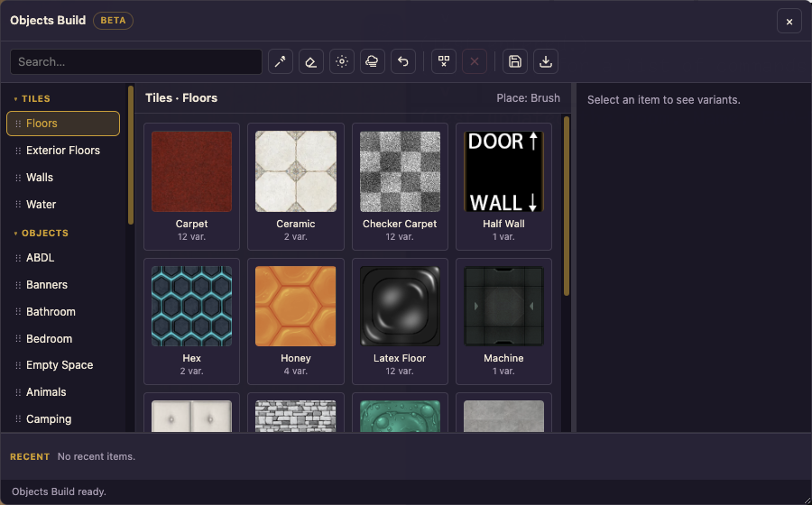
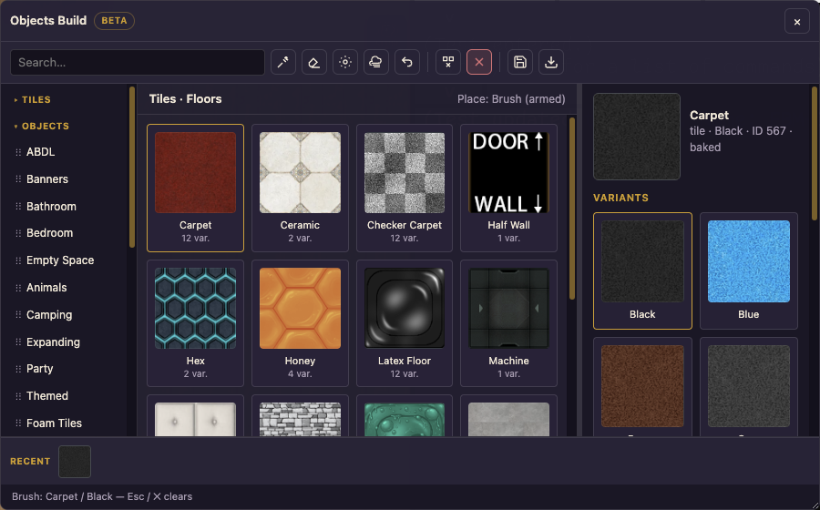
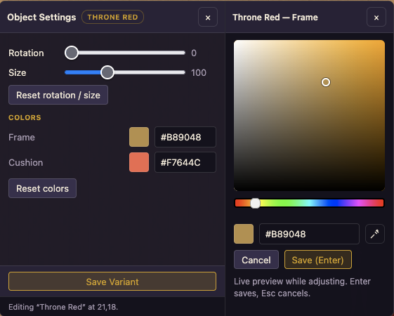

# Objects Build

Objects Build is a floating catalog for tiles, objects, and effects. It supports search, hybrid style-suffix grouping for tiles, brush or single place, pipet / eraser / fog / undo, and custom variants — and it works when Club’s map toolbar is hidden.

## When to use this

Use Objects Build when you want a clearer picker than Club’s built-in map tools, or when Club chrome is collapsed behind FBM’s **+**.

## Requirements

| | |
|---|---|
| Build bar | Open (admin) |
| Command | `/build` also opens the catalog |

---

## Opening

1. Open the [build bar](BUILD_BAR.md).
2. Click **Build**, or type **`/build`**.

---

## Catalog

- Left tree: **Tiles**, **Objects**, **Effects** categories.
- Center grid: cards with thumbnails and variant counts.
- **Icons** slider (action bar) scales catalog / variants thumbs from 48–96px (default 96) so you can fit more items on screen.
- Search filters the catalog.
- Pick a category, then a card — Club **Brush** is armed.
- With a brush armed, a translucent **placement ghost** follows the cursor on tiles where Club allows the item (e.g. doors only on walls). Toggle under Settings → General (on by default).

Toggle **Single** for one-shot place instead of continuous brush.

### Tools

| Tool | Role |
|------|------|
| Pipet | Sample a placed object (can save settings as a variant) |
| Eraser | Erase mode |
| Object settings | Open FBM Object Settings pick mode |
| Fog | Fog tool |
| Undo | Undo last paint |
| Single | One-shot place |
| Clear | Clear drawing selection (Esc) |

Category order, custom variants, recent items, window size, and icon size persist in **localStorage**.

---

## Object Settings

FBM’s Object Settings modal lets you adjust rotation, size, color layers, tether, decal, and related fields even when Club map chrome is hidden.

1. Click the gear / Object settings tool, or gear on a customizable object.
2. Click a customizable object on the map.
3. Edit rotation, size, and color layers; use the live color picker and eyedropper; **Enter** saves colors.
4. **Save Variant** writes the current look into the Objects catalog as a custom thumb.

**Sign** and **Teleporter** are excluded from this gear path (use Club / copy Obj settings instead).

---

## Storage

| Data | Where |
|------|--------|
| Custom variants, recent, category order, window size | `localStorage` |

## Related

- [BUILD_BAR.md](BUILD_BAR.md)
- [COPY_PASTE.md](COPY_PASTE.md)
- [COMMANDS.md](COMMANDS.md)
