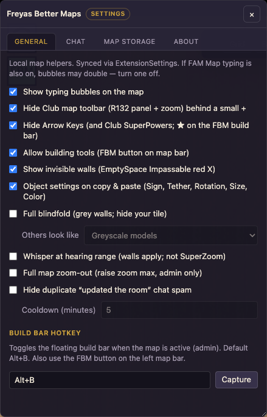
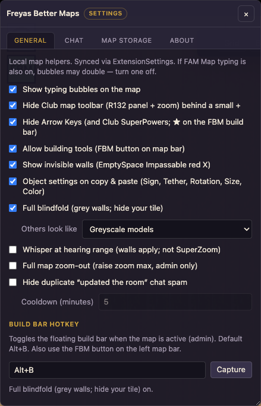
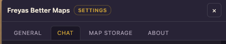
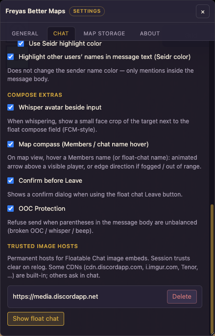
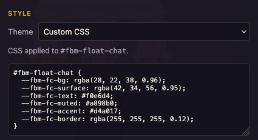
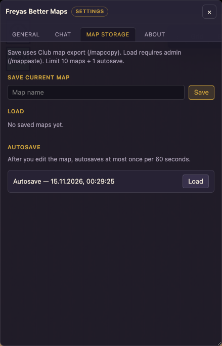
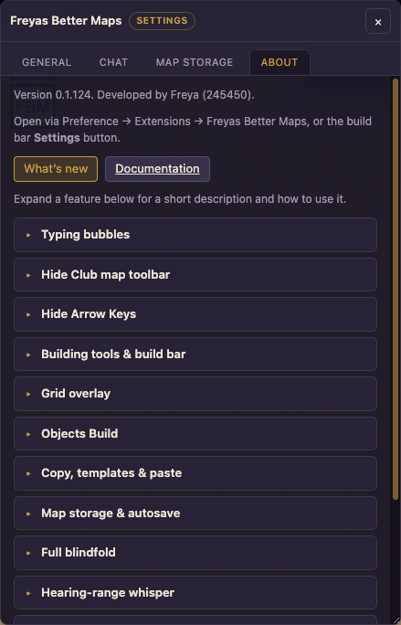
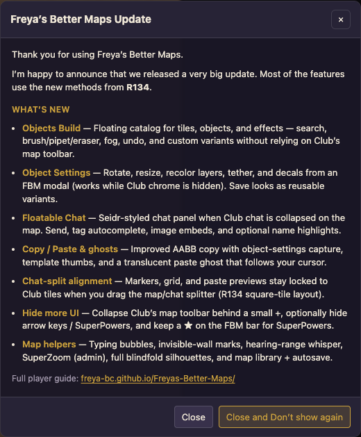

# Settings

Freyas Better Maps settings live in a draggable HTML panel. Almost every option is here: General map helpers, Floatable Chat, Map storage, and About.

Open it with:

- **Preference → Extensions → Freyas Better Maps**, or  
- Build bar → **Settings**, or  
- Floatable Chat → Menu → **Chat Settings** (opens on the Chat tab)

Tabs: **General** | **Chat** | **Map storage** | **About**.

---

## General

| Option | Default | Meaning |
|--------|---------|---------|
| Show typing bubbles on the map | On | Talk bubbles above typing characters |
| Hide Club map toolbar | On | Collapse Club left chrome behind **+** |
| Hide Arrow Keys | Off | Hide movement pad / SuperPowers; ★ on build bar |
| Allow building tools | On | Show FBM map button / allow build bar |
| Show invisible walls | Off | Red X on EmptySpace Impassable |
| Object settings on copy & paste | On | Include Sign/Tether/rotation/size/color |
| Full blindfold | Off | Grey walls / short range when fully blind |
| Others look like | Greyscale models | Greyscale or generic silhouette |
| Whisper at hearing range | Off | Whisper when hearable + in range |
| Full map zoom-out | Off | Raise zoom max (**admin only**) |
| Hide duplicate room-update chat spam | Off | Suppress matching update lines |
| Cooldown (minutes) | 5 | 1–120 |
| Build bar hotkey | Alt+B | Capture or type |

Details: [MAP_VIEW.md](MAP_VIEW.md), [BUILD_BAR.md](BUILD_BAR.md).

---

## Chat

| Option | Default | Meaning |
|--------|---------|---------|
| Enable Floatable Chat | On | Master switch |
| Autoshow when Club chat hidden | On | Pop panel when Club chat collapses |
| Autoclose chat joining a room | Off | Collapse Club chat on join |
| Hotkey | Alt+C | Capture or type |
| Text size | 13 | 11–18 |
| Transparency | 15% | 0–60 glass |
| Font | system | Dropdown + Custom… |
| Theme | Dark (Seidr) | Dark / Light Seidr / Custom CSS |
| Highlight own names/words | Off | + Seidr color or custom |
| Highlight other users’ names | Off | Seidr color |
| Whisper avatar | Off | Face beside compose |
| Map compass | Off | Arrow on name hover |
| Confirm before Leave | Off | Confirm dialog |
| OOC Protection | On | Block unbalanced `()` |
| Trusted image hosts | — | Permanent allow list |
| Show float chat | — | Opens the panel now |

Details: [FLOATABLE_CHAT.md](FLOATABLE_CHAT.md).

---

## Map storage

Save named maps, load / delete slots, and load autosave. See [MAP_STORAGE.md](MAP_STORAGE.md).

---

## About

- Version and author credit
- **What’s new** — reopen the changelog modal
- **Documentation** — opens these Pages docs
- Collapsible per-feature help (same topics as the guides)

---

## Where settings are stored

| Data | Where |
|------|--------|
| Toggles, float-chat preferences | `ExtensionSettings.FreyasBetterMaps` (synced, small) |
| Named map library | `ExtensionSettings.FreyasBetterMapsMaps` (synced) |
| Panel / float-chat position and size, float-chat hidden, members split, autosave | `localStorage` (this device only) |
| Templates, Objects Build customs / recent | `localStorage` |
| Map overflow (full copies) | `localStorage` |

Changes are sent to the server after a short delay (~1.5 s), only if something actually changed, and always when you leave the room or reload.

## Related

- [README.md](../README.md)
- [MAP_VIEW.md](MAP_VIEW.md)
- [FLOATABLE_CHAT.md](FLOATABLE_CHAT.md)
- [MAP_STORAGE.md](MAP_STORAGE.md)
